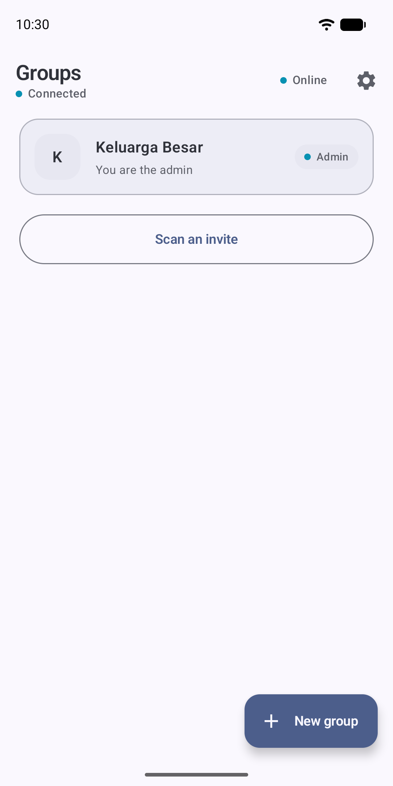
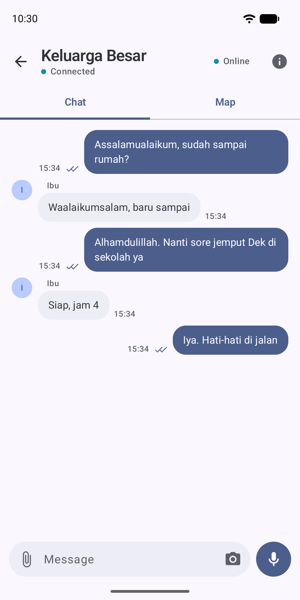
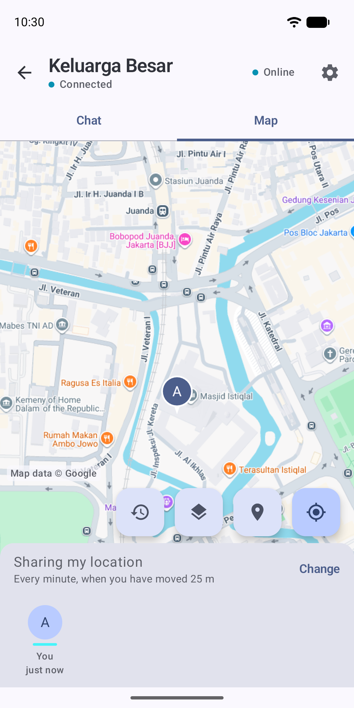
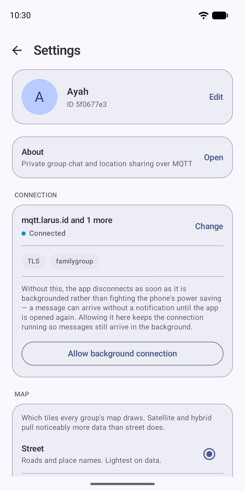

# mqtt-group

Private group chat, voice calls and live location sharing over MQTT, encrypted end to end.
There is no server of its own and no account to create. Each group talks through an MQTT
broker you choose, and the broker only ever sees ciphertext and random topic names.

The repository holds two clients that speak the same wire format and can share one group:

| Folder | Client | Stack |
|---|---|---|
| [`android/`](android/) | Native Android app | Kotlin, Jetpack Compose, minSdk 29 |
| [`pwa/`](pwa/) | Installable web app | SvelteKit 5, TypeScript, static build |

<p>
  
  
  
  
</p>

## Why I made this

I wanted a private way to chat with my family and see where everyone is, without handing
our messages and locations to a big platform. This app runs on any MQTT broker, encrypts
everything on the device before it leaves, shows no ads and has no accounts. It does chat,
calls and location, which is what I use, and nothing more. I use it with my own family.

## Wire compatibility

The two clients are kept in step by shared test vectors. `pwa/vectors/wire-vectors.json` is
generated by the web app's codecs and checked by the Android app's `WireVectorsTest`, which
looks for it at `../pwa` relative to `android/`. If you change the format in one client, change
it in the other too and regenerate the vectors.

## Building

Each folder builds on its own; there is no root build.

```
cd android && ./build.sh          # debug APK (needs JDK 17+ and the Android SDK)
cd android && ./build.sh test     # unit tests, including the wire vectors

cd pwa && npm ci && npm run dev   # local dev server
cd pwa && npm run build           # static site in pwa/build/
```

See [`android/README.md`](android/README.md) and [`pwa/README.md`](pwa/README.md) for details.

## Configuration that is not in the repository

Secrets and per-deployment files are gitignored. Without them the apps still build; only push
notifications and release signing need them.

| File | Used by | What goes in it |
|---|---|---|
| `android/app/google-services.json` | Android | Your Firebase project's Android config (Firebase console → Project settings). The Gradle build requires this file. |
| `android/secrets.properties` | Android | `fcmAuth=user:password` for the push relay. Or set `FCM_AUTH` in the environment. |
| `android/keystore.properties` | Android | Release signing. Copy it from `keystore.properties.example`. |
| `pwa/.env` | PWA | `VITE_FCM_AUTH=user:password` for the push relay. Copy it from `.env.example`. |

The Firebase web config in `pwa/src/lib/push/firebaseApp.ts` is a public client identifier. To
use your own Firebase project, swap in its values and the VAPID key in `pushTopics.ts`.

Push notifications are only a doorbell ("someone posted, go look"). Message content always
travels as MQTT ciphertext, never through Firebase.
